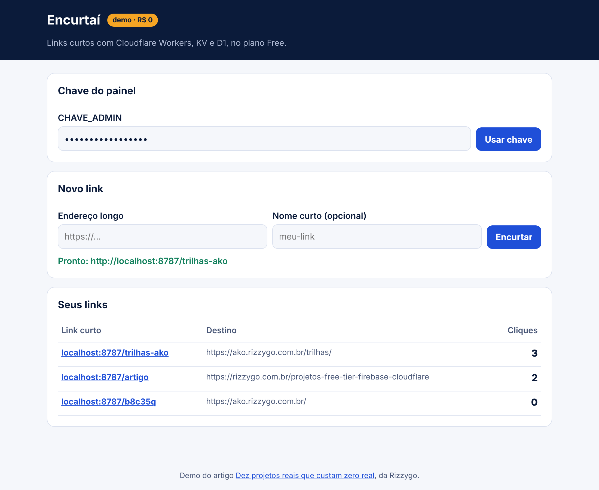
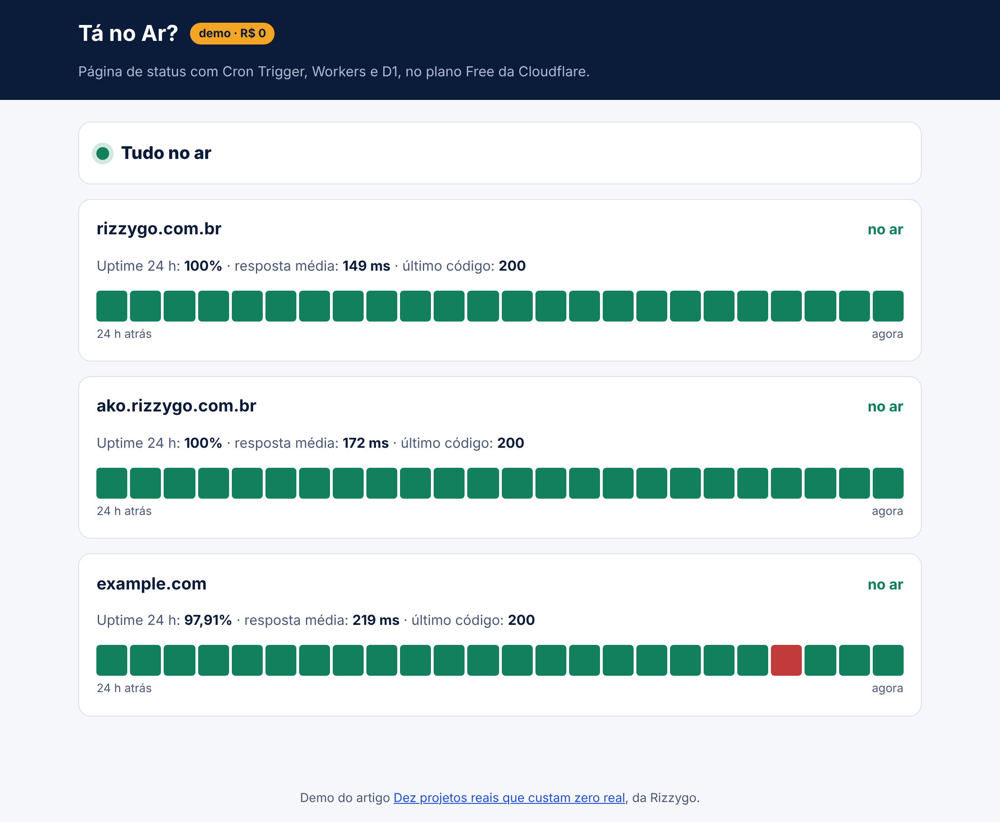
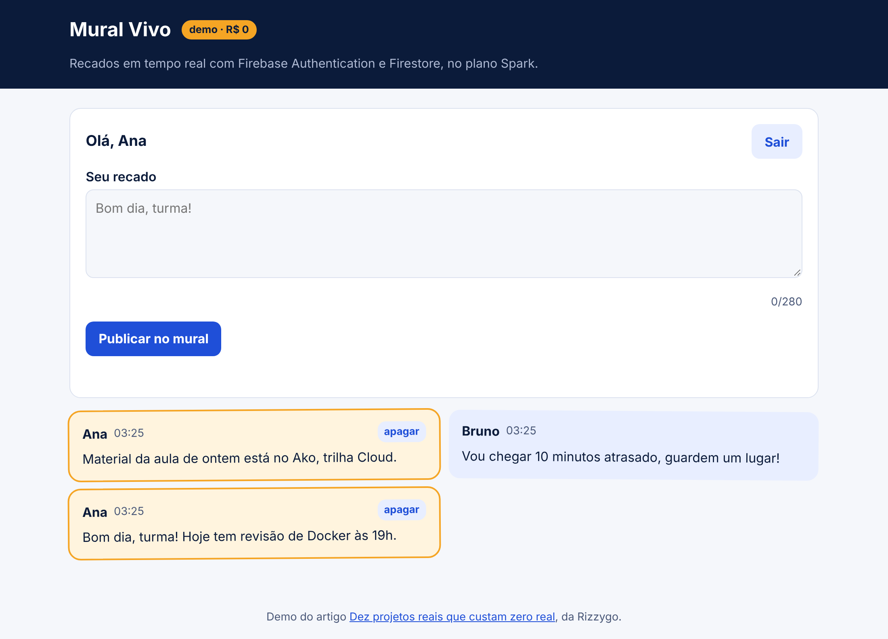
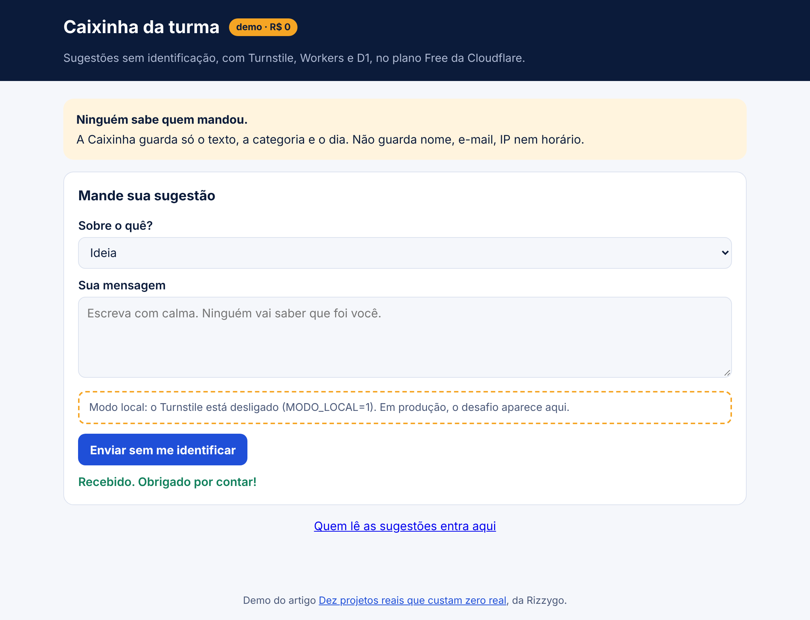
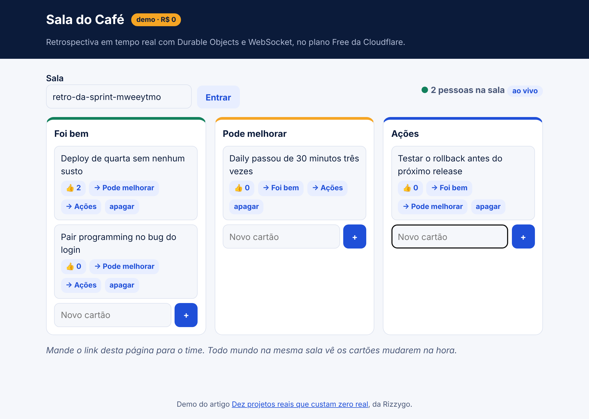
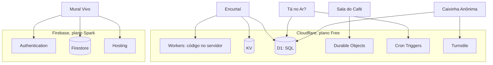

# Rizzygo Demos: cinco projetos que custam zero real

Projetos de portfólio prontos para rodar, estudar e publicar só com o plano Spark do Firebase e o plano Free da Cloudflare. Sem cartão e sem gastar 1 real.

São as demos do artigo [Dez projetos reais que custam zero real](https://rizzygo.com.br/projetos-free-tier-firebase-cloudflare), da Rizzygo. Cada pasta tem o código, a arquitetura em desenho, o passo a passo para rodar e publicar, a conta da cota e um prompt para construir do zero com IA.

| | Demo | O que faz | Usa | Nível |
| --- | --- | --- | --- | --- |
|  | [**Encurtaí**](demos/encurtai/) | Encurtador de links com contagem de cliques | Workers, KV, D1 | Iniciante |
|  | [**Tá no Ar?**](demos/ta-no-ar/) | Página de status que testa seus sites a cada 5 minutos | Workers, Cron Triggers, D1 | Iniciante |
|  | [**Mural Vivo**](demos/mural-vivo/) | Mural de recados em tempo real | Firebase Authentication, Firestore, Hosting | Iniciante |
|  | [**Caixinha Anônima**](demos/caixinha-anonima/) | Sugestões sem identificação, protegidas contra robô | Workers, Turnstile, D1 | Intermediário |
|  | [**Sala do Café**](demos/sala-do-cafe/) | Retrospectiva ao vivo com várias pessoas | Workers, Durable Objects, WebSocket | Avançado |

Os prints saíram das demos rodando localmente, com `npm run prints`.

## Cinco passos: da escolha ao desafio

1. Escolha só uma demo. Se é a primeira vez, comece pelo Encurtaí ou pelo Mural Vivo.
2. Rode no seu computador. Nenhuma demo pede conta para rodar local.
3. Leia o código com calma. Ele é curto e comentado em português.
4. Publique de graça seguindo o README da demo.
5. Faça um dos desafios do fim do README. Esse é o pedaço que vira seu, e o que vale contar numa entrevista.

Prefere construir do zero? Cada demo tem um `PROMPT.md` para colar na IA de código que você usa. Ele pede para a IA ir em etapas, explicar antes de rodar e conferir com você.

## Rodar uma demo no seu computador

Precisa de [Node.js](https://nodejs.org/) 20 ou mais novo. O Mural Vivo precisa também do Java 21, para o emulador do Firestore.

```sh
git clone https://github.com/rizzygo/rizzygo-demos
cd rizzygo-demos
npm install
cd demos/encurtai     # ou outra demo
# siga o "Rodar no seu computador" do README da demo
```

## Os serviços que cada demo usa



O Firebase gratuito não roda código no servidor: o Cloud Functions exige o plano Blaze, que pede cartão. Por isso as demos que precisam de servidor usam Workers.

## Regras para não gastar 1 real

- Não ligue conta de faturamento no Firebase. Isso passa o projeto para o Blaze.
- Fique no plano Free dos Workers. Passou da cota, o Worker devolve erro em vez de cobrar.
- Use os endereços gratuitos `web.app` e `workers.dev`.
- Segredo nunca entra no git: use `.dev.vars` (ignorado) no seu computador e `wrangler secret put` na nuvem.

Os limites de cada plano estão no [artigo](https://rizzygo.com.br/projetos-free-tier-firebase-cloudflare#o-que-vem-de-graca), com os links das páginas oficiais. Os planos mudam: confira antes de publicar.

## Os outros cinco projetos do artigo ficam como desafio

Zumbido, Diário de Bordo, Bolão sem Boleto, Pergunta pra Doc e Capa Pronta não têm demo aqui. Use estas demos como ponto de partida: as peças se repetem.

## Para quem quer contribuir

- `npm run conferir` roda o mesmo que o CI: confere a estrutura de cada demo e se todas montam sem erro.
- `npm run prints` refaz os prints com as demos rodando (precisa do Playwright).
- Regras para agentes de IA e pessoas: [AGENTS.md](AGENTS.md).

## Licença

[GPL-3.0](LICENSE). Feito pela Rizzygo, dentro da Rizzygo All: conteúdo aberto e gratuito, em português.
