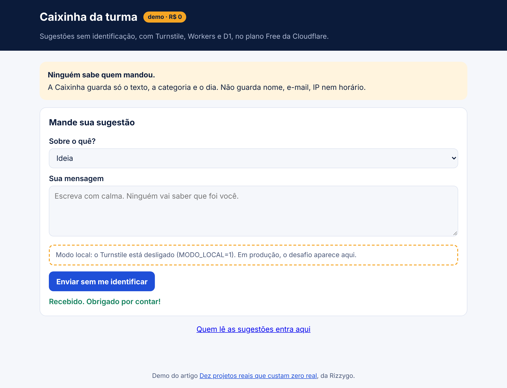
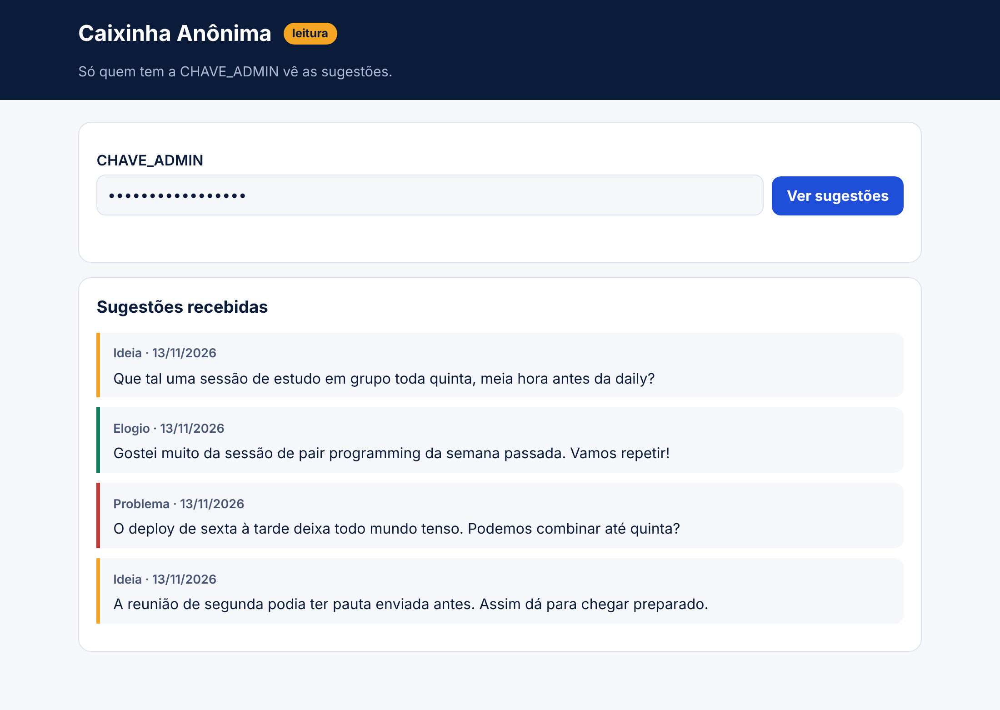
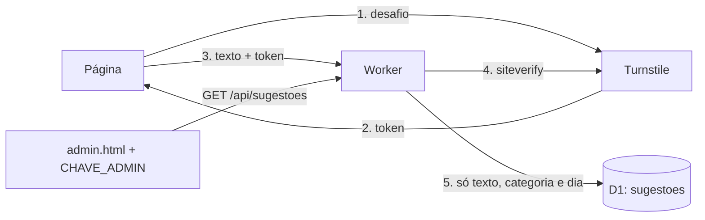

# Caixinha Anônima

Caixa de sugestões para um time ou uma turma, em que ninguém precisa se identificar. Roda no plano Free da Cloudflare, sem cartão.

| Quem manda | Quem lê |
| --- | --- |
|  |  |

> Nos prints, o Turnstile está em modo local (`MODO_LOCAL=1`), por isso aparece o aviso tracejado no lugar do desafio. Publicado, o desafio aparece ali.

## O problema

Muita gente tem uma boa ideia ou uma crítica justa e não fala por medo de se expor. Formulário anônimo aberto, por outro lado, vira alvo de robô.

## O que você aprende

- **Turnstile**: barrar robô sem fazer a pessoa clicar em semáforo.
- **Validação no servidor**: o token do Turnstile é conferido pelo Worker, nunca pela página.
- **Privacidade**: o que não se guarda não vaza.

## Arquitetura



A Caixinha não guarda nome, e-mail, IP, navegador nem horário. Guarda só o dia. Com a hora exata, daria para cruzar com quem estava online e descobrir quem mandou.

## Rodar no seu computador (sem conta)

```sh
npm install                       # na raiz, uma vez
cd demos/caixinha-anonima
cp .dev.vars.example .dev.vars
npm run banco
npm run dev                       # http://localhost:8789
```

O `.dev.vars.example` traz a chave secreta de teste da Cloudflare, e o `wrangler.jsonc` traz a sitekey de teste. As duas sempre passam. Sem internet, troque para `MODO_LOCAL=1` no `.dev.vars` e o Worker pula a conferência.

A página de leitura fica em http://localhost:8789/admin.html.

## Publicar de graça

1. No painel da Cloudflare, abra **Turnstile**, crie um widget e copie a sitekey e a chave secreta.
2. Troque a `TURNSTILE_SITEKEY` no `wrangler.jsonc`.
3. Rode:

```sh
npx wrangler login
npx wrangler d1 create caixinha-anonima          # copie o database_id para o wrangler.jsonc
npx wrangler d1 execute caixinha-anonima --remote --file=schema.sql
npx wrangler secret put TURNSTILE_SECRET
npx wrangler secret put CHAVE_ADMIN
npm run deploy
```

Não crie `MODO_LOCAL` em produção.

## Quanto da cota ele gasta

| Ação | Gasta | Limite grátis por dia |
| --- | --- | --- |
| Mandar uma sugestão | 1 requisição, 1 chamada ao siteverify e 1 linha gravada no D1 | 100 mil requisições, 100 mil linhas gravadas |
| Abrir a página de leitura | 1 requisição e até 200 linhas lidas no D1 | 5 milhões de linhas lidas |
| Desafio do Turnstile | não entra na cota dos Workers | grátis, sem limite de desafios |

## Desafios para ir além

1. Limite quantas sugestões o mesmo navegador manda por hora, sem guardar IP.
2. Deixe quem lê marcar uma sugestão como "feito" e mostre isso na página pública.
3. Troque a `CHAVE_ADMIN` por login com Firebase Authentication.

## Construa do zero com IA

O [PROMPT.md](PROMPT.md) tem um roteiro para colar em qualquer IA e construir este projeto passo a passo.
