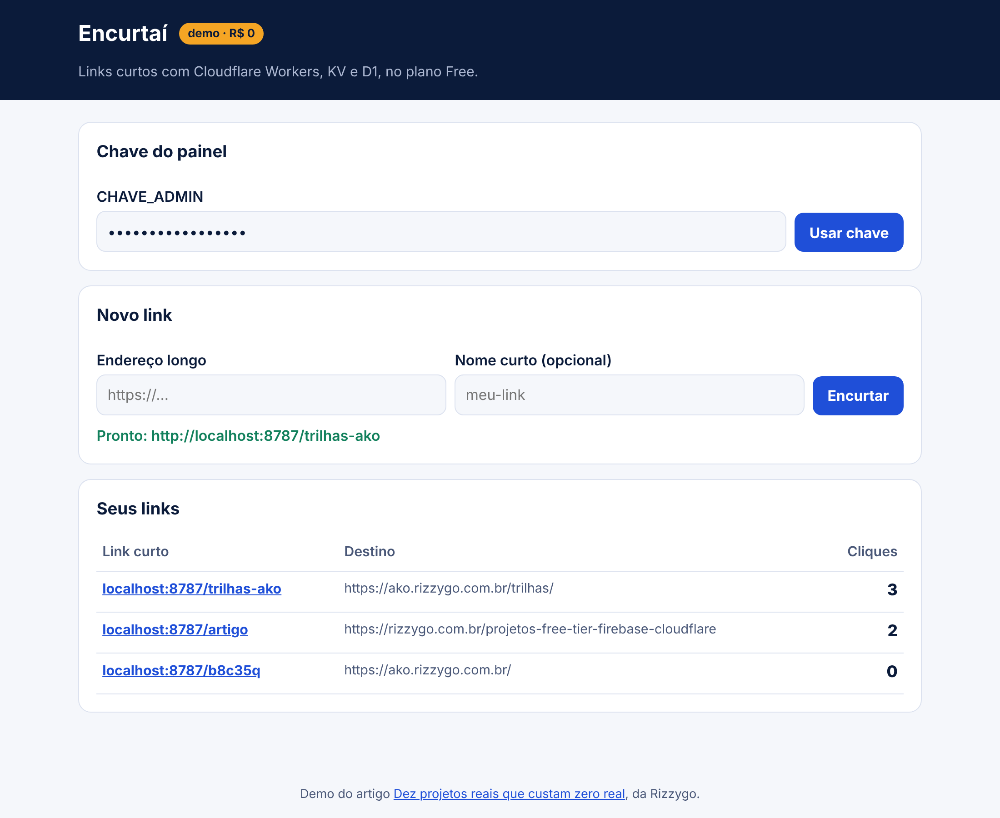
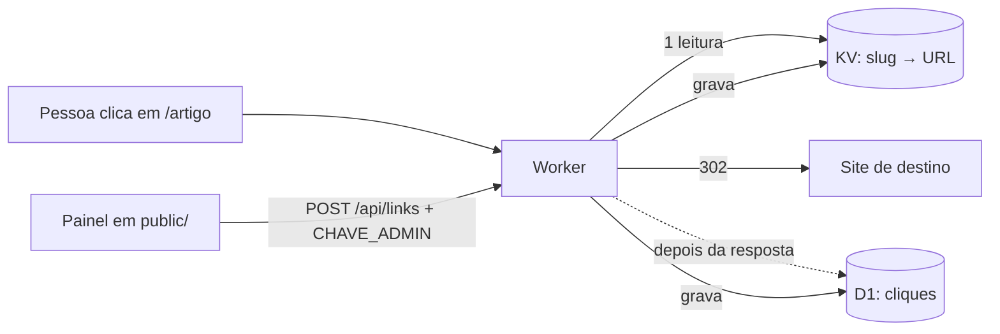

# Encurtaí

Encurtador de links com contagem de cliques. Roda no plano Free da Cloudflare, sem cartão.



## O problema

Link longo não cabe em post, em slide nem em QR code pequeno. E você quer saber quantas pessoas clicaram.

## O que você aprende

- Código na borda com **Workers**: o redirect acontece perto de quem clicou.
- **KV** para leitura rápida e **D1** (SQL) para o que grava muito.
- Redirect 302, `ctx.waitUntil` e segredo com `wrangler secret`.

## Arquitetura



O Encurtaí usa dois bancos porque o KV aguenta 100 mil leituras por dia, mas só mil gravações. Cada clique é uma gravação, então os cliques vão para o D1, que aceita 100 mil gravações por dia. O KV fica só com o que quase não muda: o destino de cada link.

## Rodar no seu computador (sem conta)

Precisa de Node.js 20 ou mais novo.

```sh
# na raiz do repositório, uma vez
npm install

cd demos/encurtai
cp .dev.vars.example .dev.vars     # a chave do painel em modo local
npm run banco                      # cria as tabelas no D1 local
npm run dev                        # http://localhost:8787
```

Abra o painel, cole a chave do `.dev.vars` e crie um link. Teste no terminal:

```sh
curl -i http://localhost:8787/nome-do-link   # deve voltar 302 com o destino
```

## Publicar de graça

```sh
npx wrangler login
npx wrangler kv namespace create LINKS          # copie o id para o wrangler.jsonc
npx wrangler d1 create encurtai                 # copie o database_id para o wrangler.jsonc
npx wrangler d1 execute encurtai --remote --file=schema.sql
npx wrangler secret put CHAVE_ADMIN             # digite uma chave forte
npm run deploy                                  # sai em https://encurtai.<sua-conta>.workers.dev
```

## Quanto da cota ele gasta

| Ação | Gasta | Limite grátis por dia |
| --- | --- | --- |
| Clique | 1 requisição, 1 leitura de KV, 1 linha gravada no D1 | 100 mil requisições, 100 mil leituras, 100 mil linhas |
| Link novo | 1 gravação de KV, 1 linha no D1 | mil gravações de KV |
| Abrir o painel | 1 consulta que lê os links e os cliques no D1 | 5 milhões de linhas lidas |

## Desafios para ir além

1. Troque a `CHAVE_ADMIN` por login com Firebase Authentication e confira o token no Worker.
2. Mostre os cliques por dia num gráfico.
3. Gere um QR code para cada link.

## Construa do zero com IA

O [PROMPT.md](PROMPT.md) tem um roteiro para colar em qualquer IA e construir este projeto passo a passo, entendendo cada parte.
