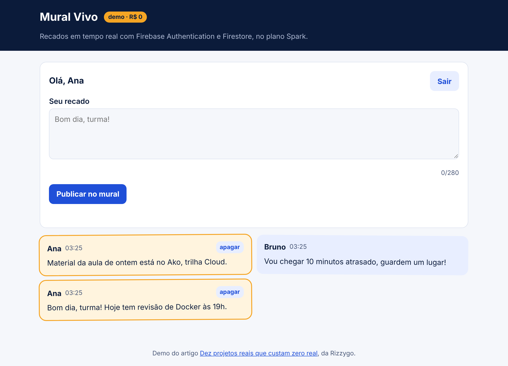
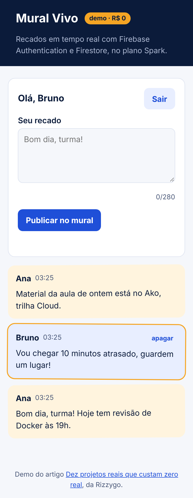
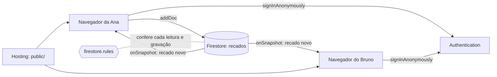

# Mural Vivo

Mural de recados da turma que atualiza na tela de todo mundo, sem recarregar. Roda no plano Spark do Firebase, sem cartão.

| Ana, no computador | Bruno, no celular, vê o recado dela na hora |
| --- | --- |
|  |  |

## O problema

O grupo da turma vira bagunça e os avisos importantes somem. Um mural simples, que atualiza sozinho, resolve.

## O que você aprende

- **Firebase Authentication** (login anônimo com apelido).
- **Firestore** com listener em tempo real (`onSnapshot`).
- **Regras de segurança**: o servidor barra o que a página não deveria fazer.
- Rodar tudo nos **emuladores** do Firebase, sem conta e sem internet.

## Arquitetura



Não tem servidor seu no meio. A página fala direto com o Firestore, e as regras em `firestore.rules` decidem o que pode: só quem entrou lê, cada pessoa só escreve no próprio nome, o texto tem até 280 caracteres e só quem escreveu apaga.

## Quanto da cota ele gasta: uma leitura por pessoa a cada recado

Cada recado novo gera uma leitura para cada pessoa com o mural aberto. Com 30 pessoas na turma, 100 recados por dia já são 3 mil leituras. O limite grátis é 50 mil por dia. O `limit(50)` na consulta impede que abrir a página leia o mural inteiro.

## Rodar no seu computador (sem conta)

Precisa de Node.js 20 ou mais novo e Java 21 (para o emulador do Firestore).

```sh
npm install              # na raiz, uma vez
cd demos/mural-vivo
npm run dev              # monta o app.js e sobe os emuladores
```

- Mural: http://127.0.0.1:5000 (abra em duas janelas anônimas para ver o tempo real)
- Painel dos emuladores: http://127.0.0.1:4000

O projeto se chama `demo-mural-vivo`. O prefixo `demo-` faz o Firebase CLI rodar tudo local, sem pedir login.

## Publicar de graça

1. Crie um projeto no [Console do Firebase](https://console.firebase.google.com/). Ele começa no plano Spark. **Não ligue faturamento.**
2. Em Authentication, ative o provedor **Anônimo**.
3. Crie o Firestore.
4. Em Configurações do projeto, registre um app Web e copie a configuração para `src/config.js`.
5. Troque `demo-mural-vivo` pelo id do seu projeto no `.firebaserc`.
6. Rode:

```sh
npx firebase login
npm run deploy           # publica o site e as regras em https://<seu-projeto>.web.app
```

## Desafios para ir além

1. Troque o login anônimo por login com Google.
2. Crie salas: um mural por turma, com a regra conferindo quem participa.
3. Mostre quantas pessoas estão com o mural aberto. Dica: o Realtime Database tem presença online pronta.

## Construa do zero com IA

O [PROMPT.md](PROMPT.md) tem um roteiro para colar em qualquer IA e construir este projeto passo a passo.
