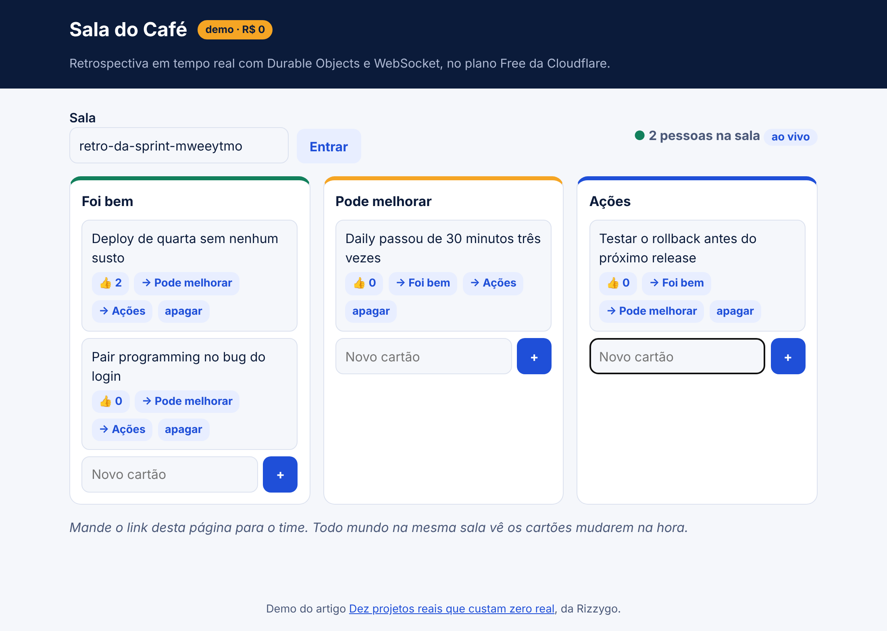
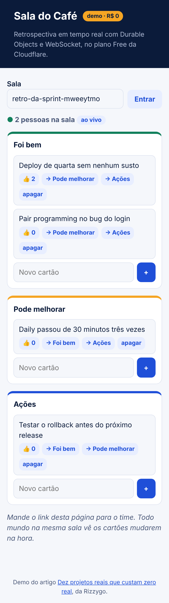
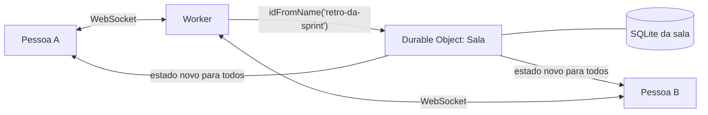

# Sala do Café

Quadro de retrospectiva em que várias pessoas mexem nos mesmos cartões ao mesmo tempo. Roda no plano Free da Cloudflare, sem cartão.

| No computador | No celular, na mesma sala |
| --- | --- |
|  |  |

## O problema

Retrospectiva remota em planilha compartilhada é lenta e confusa. Um quadro simples, ao vivo, com voto, resolve.

## O que você aprende

- **Durable Objects**: um objeto por sala, dono único do estado.
- **WebSocket** com a Hibernation API: o objeto dorme entre mensagens sem derrubar ninguém.
- **SQLite dentro do objeto**: cada sala tem o próprio banco.
- Reconexão com espera crescente (backoff).

## Arquitetura



Só um Worker com banco não basta. Workers não guardam estado entre requisições e podem rodar em vários lugares ao mesmo tempo. Duas pessoas votando juntas poderiam se atropelar. O Durable Object é um só por sala: as mensagens chegam uma de cada vez, na ordem.

## Rodar no seu computador (sem conta)

```sh
npm install              # na raiz, uma vez
cd demos/sala-do-cafe
npm run dev              # http://localhost:8790
```

Abra o mesmo endereço, com o mesmo `?sala=`, em duas janelas. Crie um cartão numa e veja aparecer na outra.

## Publicar de graça

```sh
npx wrangler login
npm run deploy           # sai em https://sala-do-cafe.<sua-conta>.workers.dev
```

No plano Free, Durable Objects só funcionam com armazenamento em SQLite. Por isso o `wrangler.jsonc` usa `new_sqlite_classes`.

## Quanto da cota ele gasta

O limite grátis é de 100 mil requisições por dia para Durable Objects. Mesmo contando cada clique como uma requisição, uma retrospectiva de 8 pessoas com uns 200 cliques fica muito longe disso. Com a Hibernation API, o tempo parado esperando a próxima mensagem não conta como duração.

## Desafios para ir além

1. Mostre o nome de quem está na sala.
2. Adicione um cronômetro compartilhado para cada etapa da retro.
3. Exporte o resultado em Markdown no fim.

## Construa do zero com IA

O [PROMPT.md](PROMPT.md) tem um roteiro para colar em qualquer IA e construir este projeto passo a passo.
