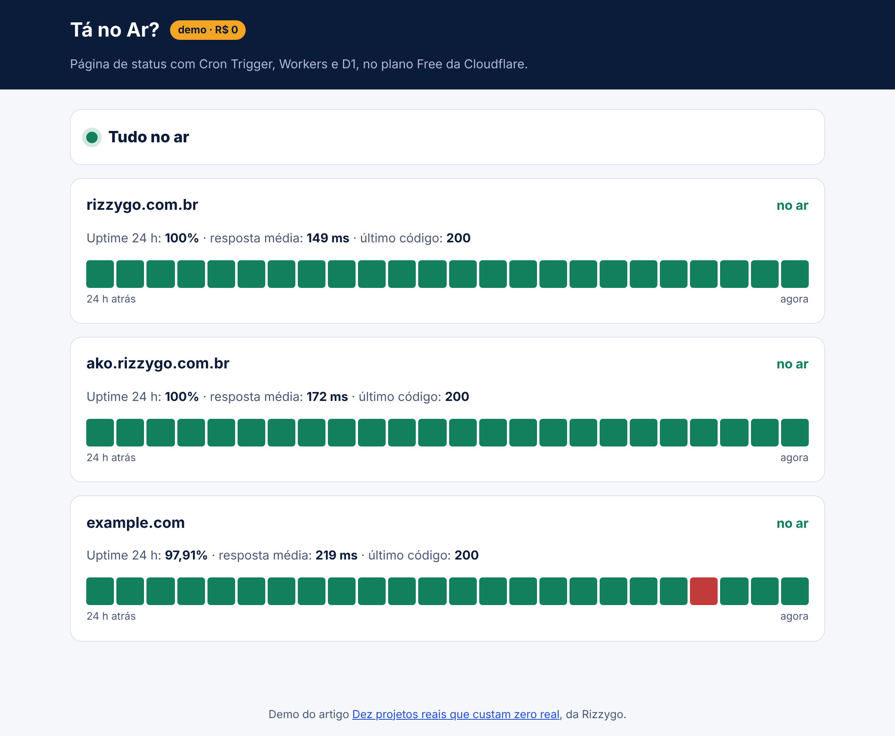
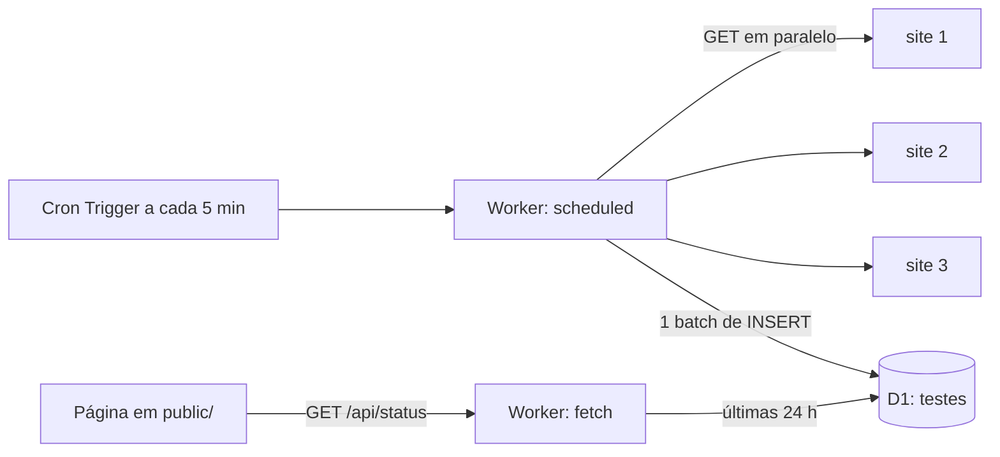

# Tá no Ar?

Página de status que testa os seus sites a cada 5 minutos e mostra as últimas 24 horas. Roda no plano Free da Cloudflare, sem cartão.



> O print usa os dados de exemplo do `exemplo.sql`, para mostrar 24 horas de histórico sem esperar um dia.

## O problema

Seu site cai de madrugada e você só descobre quando alguém reclama. Uma página de status mostra se está no ar e desde quando.

## O que você aprende

- **Cron Trigger**: código que roda sozinho de tempos em tempos.
- **D1** (SQL) para guardar o histórico e calcular uptime.
- Uptime, tempo de resposta e o começo de um SLO.

## Arquitetura



Cada teste vira uma linha. A cada 5 minutos, são 288 linhas por site por dia, bem longe das 100 mil gravações por dia do D1. O Worker apaga o que passou de 7 dias.

Os 10 ms de CPU do plano Free bastam: esperar a resposta dos sites é tempo de rede, e rede não conta como CPU.

## Rodar no seu computador (sem conta)

```sh
npm install                 # na raiz, uma vez
cd demos/ta-no-ar
npm run banco               # cria a tabela no D1 local
npm run exemplo             # opcional: 24 h de dados de exemplo
npm run dev                 # http://localhost:8788
```

Para disparar um teste na hora, sem esperar o cron:

```sh
curl "http://localhost:8788/__scheduled?cron=*/5+*+*+*+*"
```

Troque os sites em `vars.SITES` no `wrangler.jsonc`.

## Publicar de graça

```sh
npx wrangler login
npx wrangler d1 create ta-no-ar                 # copie o database_id para o wrangler.jsonc
npx wrangler d1 execute ta-no-ar --remote --file=schema.sql
npm run deploy
```

O plano Free permite 5 Cron Triggers por conta. Este projeto usa 1.

## Quanto da cota ele gasta

| Item | Por dia, com 3 sites | Limite grátis por dia |
| --- | --- | --- |
| Execuções do cron | 288 | 100 mil requisições |
| Linhas gravadas no D1 | 864 | 100 mil |
| Abrir a página | 1 requisição e até 864 linhas lidas | 5 milhões de linhas lidas |

## Desafios para ir além

1. Mande um alerta quando um site cair: Web Push, como no projeto Zumbido do artigo.
2. Guarde o resumo de cada dia numa tabela separada e mostre 90 dias.
3. Teste também se a página tem um texto esperado, não só o código HTTP.

## Construa do zero com IA

O [PROMPT.md](PROMPT.md) tem um roteiro para colar em qualquer IA e construir este projeto passo a passo.
